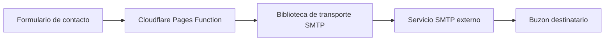
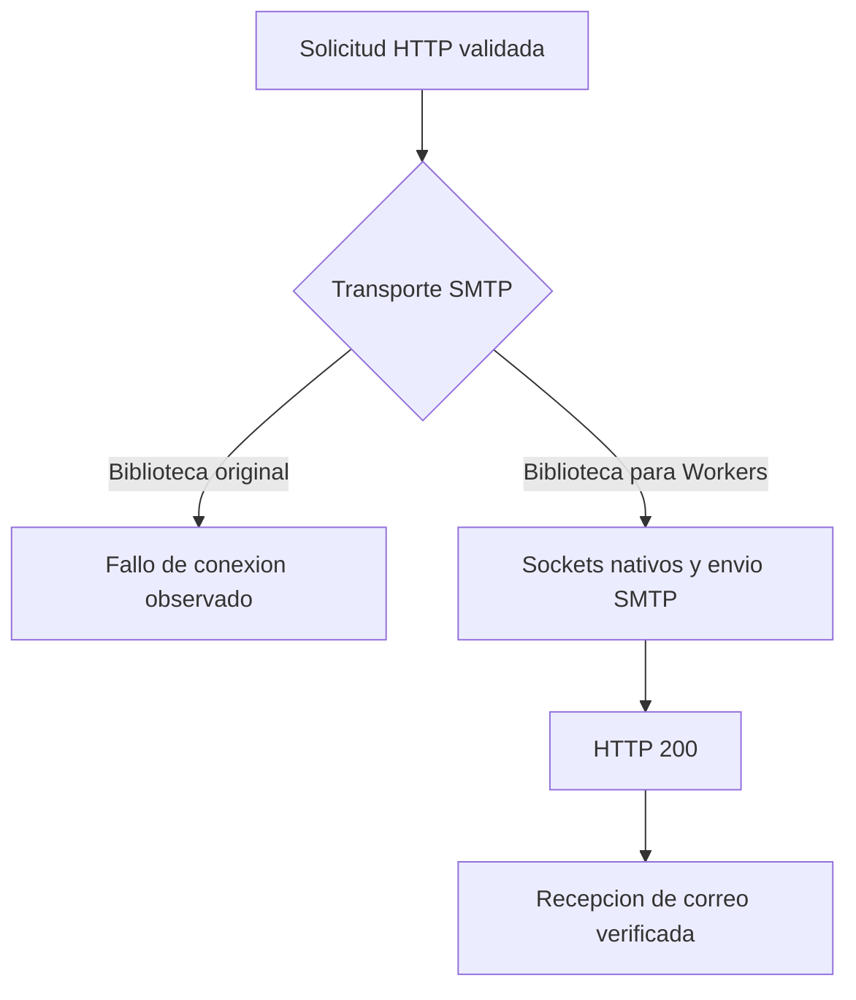

# ECS-001 · Cuando SMTP funciona, pero un formulario serverless devuelve HTTP 502

> **Estado:** Resuelto y verificado funcionalmente
> **Área:** Arquitectura cloud / integraciones serverless / diagnóstico
> **Tecnologías:** Astro (estático), Cloudflare Pages Functions, `cloudflare:sockets`, Nodemailer, `@workermailer/smtp`, SMTP externo
> **Fecha de documentación:** noviembre de 2026
> **English:** [Read this case in English](README.md)

## 1. Resumen ejecutivo

Un formulario de contacto de una web estática funcionaba a nivel de interfaz y validación, pero fallaba al enviar correos desde el entorno desplegado: el endpoint devolvía **HTTP 502**. Un servidor SMTP externo negociaba cifrado y autenticaba correctamente en pruebas locales independientes, mientras que la aplicación desplegada fallaba al utilizar **Nodemailer 10.5.0**.

Las pruebas de diagnóstico mostraron una diferencia esencial: **las conexiones directas desde Cloudflare Workers mediante sockets nativos sí funcionaban**, mientras que los intentos de conexión/verificación de Nodemailer devolvían errores asociados al transporte. Se sustituyó esa biblioteca por **`@workermailer/smtp` 0.1.4**, adaptada al runtime, sin migrar el buzón, cambiar el proveedor SMTP externo ni rediseñar la web.

La solución se validó con **HTTP 200** en el endpoint y la **recepción efectiva del mensaje**. Este documento es una *reconstrucción educativa anonimizada* de un diagnóstico concluido, no documentación productiva en bruto.

## 2. Arquitectura generalizada

La web estaba generada estáticamente con Astro. El envío se ejecutaba en una Pages Function independiente; el servidor SMTP y el buzón se alojaban externamente. El fallo afectaba al envío desde el servidor, no a la representación de la página.

## 3. Observaciones frente a interpretaciones

| Capa / prueba | Resultado observado | Qué permitía concluir |
|---|---|---|
| Disponibilidad del endpoint | GET no admitido devolvía **405** | La ruta era accesible |
| Validación de entrada | POST inválido devolvía **400** | Se ejecutaban las validaciones |
| Formulario desplegado | Intento válido terminaba en **HTTP 502** | El flujo de envío no se completaba |
| SMTP, TLS y autenticación local | Pruebas independientes correctas | Servicio y credenciales válidos **desde el entorno local** |
| TCP nativo desde Workers por **587** | Conexión correcta | Existía conectividad TCP desde el runtime |
| TLS nativo desde Workers por **465** | Conexión correcta | También era posible establecer conexión TLS |
| Nodemailer en el entorno desplegado | **`ESOCKET` / `ECONNECTION`** | El fallo se observaba en la integración biblioteca/transporte |
| Nodemailer usando la IP del servidor | Continuó fallando | El DNS por sí solo no explicaba el error |
| Transporte orientado a Workers | Endpoint **200**, correo recibido | El reemplazo resolvió el problema funcional |

**Distinción importante:** conectarse por TCP o TLS no demuestra por sí solo que la autenticación SMTP o la entrega final funcionen. Del mismo modo, una compilación correcta no garantiza que el mensaje llegue al buzón.

## 4. Secuencia de diagnóstico

1. **Aislar el comportamiento HTTP.** Comprobar que la función responde y valida solicitudes con independencia del envío de correo.
2. **Verificar el servicio externo.** Probar saludo SMTP, cifrado y autenticación desde un entorno controlado. Esto reduce hipótesis, pero no prueba compatibilidad serverless.
3. **Instrumentar el transporte fallido.** Registrar categorías de error acotadas, sin credenciales ni contenido de mensajes. Se observaron `ESOCKET` y `ECONNECTION`.
4. **Probar directamente el runtime.** Los sockets nativos `cloudflare:sockets` establecieron conexión por 587 y 465. Por ello, no era correcto concluir que el runtime carecía de conectividad SMTP en general.
5. **Descartar una explicación únicamente DNS.** Nodemailer continuó fallando al utilizar la IP del servidor.
6. **Aplicar el cambio mínimo justificado.** Sustituir la biblioteca de transporte conservando formulario, validaciones, buzón externo y hosting.
7. **Validar hasta el destinatario.** Comprobar la respuesta HTTP **y** la recepción efectiva del correo.

## 5. Registro de la decisión

**Decisión:** sustituir el transporte SMTP orientado a Node por una implementación para Workers mediante **Worker Mailer** y sockets nativos disponibles. El despliegue que superó las pruebas utilizó SMTP por **587 con STARTTLS**, con autenticación gestionada mediante secretos del entorno.

**Se conservaron:** frontend estático Astro, Cloudflare Pages Function, servidor SMTP externo, buzón, validaciones y arquitectura de DNS/dominio.

**No se implementaron:** migrar a una API HTTPS de correo, cambiar el proveedor o el buzón, instalar un adaptador SSR de Astro solo por este endpoint, ni alterar el DNS de correo sin evidencia.

**Compromiso técnico:** menos cambios de infraestructura y mejor adecuación al runtime, a cambio de mantener y probar una nueva dependencia.

## 6. Validación y cierre

| Criterio de aceptación | Resultado |
|---|---|
| Compilación de Astro | Correcta |
| Compilación de Pages Functions | Correcta |
| Endpoint tras sustituir el transporte | **HTTP 200** |
| Recepción del mensaje en el buzón | **Confirmada** |
| Conservación del proveedor y buzón externo | Sí |
| Retirada del endpoint temporal de diagnóstico | Sí |

Se retiró el endpoint temporal de diagnóstico tras las pruebas y su token no formó parte de la solución publicada. Las credenciales SMTP deben mantenerse como secretos del despliegue, nunca incorporarse al repositorio.

## 7. Qué **no** demuestra este caso

- **No** prueba que Nodemailer sea incompatible con todos los Cloudflare Workers o entornos serverless.
- **No** identifica una instrucción interna concreta de Nodemailer como causa raíz: no se obtuvo un stack trace concluyente a ese nivel.
- **No** supone que abrir un socket SMTP garantice la entrega del mensaje.
- **No** indica que fuera necesario o que se llegara a cambiar de proveedor de correo.

La conclusión respaldada por la evidencia es más precisa: **la integración observada de Nodemailer falló en ese despliegue, mientras que un transporte adaptado a Workers funcionó en las condiciones probadas**.

## 8. Lecciones reutilizables

- Separar **gestión HTTP**, **validación**, **conectividad del runtime**, **comportamiento de la biblioteca** y **entrega efectiva**.
- El éxito de una prueba local es útil, pero no garantiza el mismo comportamiento en serverless.
- Las pruebas comparativas ayudan a diferenciar problemas de red de problemas de integración con el runtime.
- No modificar DNS, hosting o proveedor sin evidencia que lo justifique.
- Una compilación correcta o un indicador de ejecución exitoso no equivalen a completar el proceso del usuario.
- Retirar instrumentos de diagnóstico temporales y revisar la gestión de secretos antes de cerrar.

## 9. Alcance y referencias

Documento técnico generalizado de un diagnóstico verificado en noviembre de 2026. **No incluye código propietario, identidad del cliente, dominio ni buzón reales, credenciales, logs ni tokens de diagnóstico.** Los diagramas son representaciones conceptuales, no capturas literales de producción.

- [Web personal](https://juanherbozo.com/)
- [Artículo técnico complementario — español](https://juanherbozo.com/es/blog/cloudflare-smtp-integration/)
- [English version](README.md)

*Verificar la URL externa del artículo antes de difundirla; este caso es comprensible sin acceso a recursos externos.*
