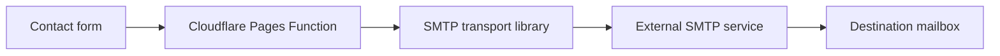
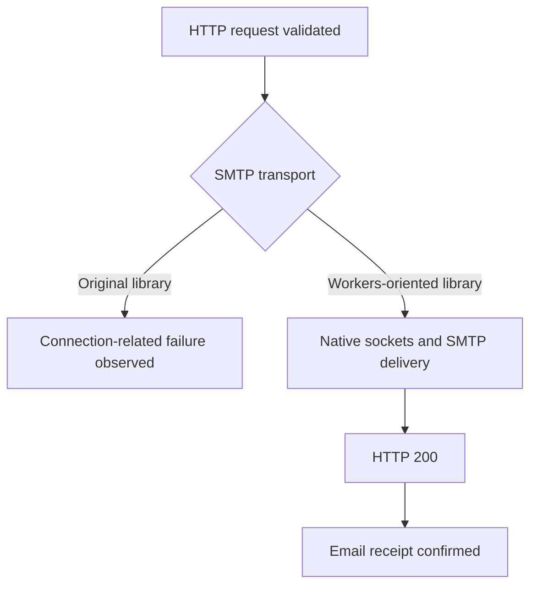

# ECS-001 · When SMTP works but a serverless form returns HTTP 502

> **Status:** Resolved and functionally verified
> **Area:** Cloud architecture / serverless integrations / diagnostics
> **Technology:** Astro (static), Cloudflare Pages Functions, `cloudflare:sockets`, Nodemailer, `@workermailer/smtp`, external SMTP
> **Documentation date:** November 2026
> **Español:** [Leer el caso en español](README.es.md)

## 1. Executive summary

A contact form on a static website worked at the interface and validation layers, yet failed during deployed email delivery. The serverless endpoint returned **HTTP 502**. An external SMTP server could authenticate and negotiate encryption in independent local tests, but the deployed application failed when using **Nodemailer 10.5.0**.

Targeted diagnostics revealed a crucial distinction: **direct connections from Cloudflare Workers using native sockets worked**, while Nodemailer's connection/verification attempts in the same deployment context returned connection-related errors. Replacing the transport with **`@workermailer/smtp` 0.1.4**, designed for this runtime, resolved the issue without moving the mailbox, changing the external SMTP provider, or redesigning the website.

The result was validated through both **HTTP 200** from the endpoint and **receipt of the actual email**. This is a *sanitized reconstruction* of a completed investigation, not raw production documentation.

## 2. Generalized architecture

The website was statically generated with Astro. Email delivery occurred in a separate Pages Function; the SMTP server and mailbox were hosted externally. The failure occurred on the server-side delivery path, not in page rendering.

## 3. Observations versus interpretations

| Layer / test | Observed result | What it established |
|---|---|---|
| Endpoint availability | An unsupported GET returned **405** | The route was reachable |
| Request validation | An invalid POST returned **400** | Input validation was executing |
| Deployed contact form | A valid attempt resulted in **HTTP 502** | The email-delivery path did not complete successfully |
| Local SMTP, TLS and authentication | Independent local SMTP client tests succeeded | The credentials/service worked **from the local environment** |
| Native Worker TCP on port **587** | Connected | TCP to SMTP was possible from the deployed runtime |
| Native Worker TLS on port **465** | Connected | A direct TLS socket was also possible from that runtime |
| Nodemailer in the deployed runtime | **`ESOCKET` / `ECONNECTION`** during diagnostics | The observed failure involved the library/transport integration path |
| Nodemailer using the server IP | Still failed | DNS name resolution alone did not explain the issue |
| Workers-oriented SMTP transport | Endpoint **200**, email received | The replacement resolved the business failure |

**Important distinction:** successful TCP or TLS connection does not, by itself, prove SMTP authentication or delivery. Likewise, a build that succeeds does not prove that email reaches the mailbox.

## 4. Diagnosis sequence

1. **Isolate HTTP behavior.** Verify that the function is reachable and that request validation responds independently of SMTP.
2. **Test external service health.** Validate SMTP greetings, encryption negotiation, and authentication from a controlled environment. This narrows the hypothesis but does not establish serverless compatibility.
3. **Instrument the failing transport.** Obtain bounded error categories without logging credentials or message contents. In this investigation, Nodemailer diagnostics produced `ESOCKET` and `ECONNECTION`.
4. **Test the runtime directly.** Native `cloudflare:sockets` connections to 587 and 465 succeeded. This contradicted the idea that the runtime had no SMTP socket connectivity at all.
5. **Rule out a simple DNS explanation.** Connecting Nodemailer to the server's IP did not eliminate the failure.
6. **Make the narrowest justified change.** Replace the SMTP transport library while preserving the form, validation logic, external mailbox, and existing hosting arrangements.
7. **Verify at the business boundary.** Check the HTTP response **and** confirm delivery to the destination mailbox.

## 5. Decision record

**Decision:** replace the Node-oriented SMTP transport with a Workers-oriented implementation using **Worker Mailer** and the available native socket capabilities. The successful deployment used SMTP on **587 with STARTTLS** and authentication configured through runtime secrets.

**Preserved:** static Astro frontend, Cloudflare Pages Function, external SMTP host, mailbox, request validation, and domain/DNS architecture.

**Not adopted:** switching providers to an HTTPS email API, migrating the mailbox, installing an Astro SSR adapter solely for this endpoint, or modifying mail DNS as a speculative fix.

**Trade-off:** fewer infrastructure changes and a tighter runtime fit, in exchange for a library change that requires its own dependency maintenance and runtime testing.

## 6. Validation and closure

| Acceptance criterion | Result |
|---|---|
| Astro static build | Passed |
| Pages Functions build | Passed |
| Form endpoint after transport change | **HTTP 200** |
| Destination mailbox receives message | **Confirmed** |
| External SMTP provider and mailbox kept | Yes |
| Temporary diagnostic endpoint removed | Yes |

The temporary diagnostic endpoint was removed after testing, and its token was not part of the published solution. SMTP credentials should remain protected as deployment secrets, never committed into source control.

## 7. What this case does **not** prove

- It does **not** establish that Nodemailer is universally incompatible with Cloudflare Workers or every serverless runtime.
- It does **not** pinpoint a specific internal Nodemailer source line or root mechanism: no conclusive low-level stack trace was obtained.
- It does **not** imply that opening an SMTP socket guarantees mail delivery.
- It does **not** imply that moving to another mail provider was required or attempted.

The evidence supports a narrower conclusion: **the observed Nodemailer integration failed in this deployment, while a Workers-oriented transport succeeded under the tested conditions**.

## 8. Reusable lessons

- Separate **HTTP handling**, **request validation**, **runtime connectivity**, **transport-library behavior**, and **actual delivery**.
- An independent local success is valuable but is not proof of identical behavior in a serverless runtime.
- Use differential experiments to discriminate between a network problem and a library/runtime integration problem.
- Avoid changes to DNS, hosting, or providers until the evidence justifies them.
- A successful build or a green dashboard metric is not equivalent to a completed user journey.
- Remove temporary instrumentation and review secrets before closing the incident.

## 9. Scope and references

This document is a generalized educational case based on a verified troubleshooting exercise in November 2026. **No proprietary code, customer identity, real domain, mailbox, credentials, logs, or diagnostic tokens are included.** The diagrams are schematic rather than verbatim system captures.

- [Personal website](https://juanherbozo.com/)
- [Companion technical article — English](https://juanherbozo.com/en/blog/cloudflare-smtp-integration/)
- [Versión en español](README.es.md)

*Check the external article URL before distributing it; this case study is complete without external access.*
